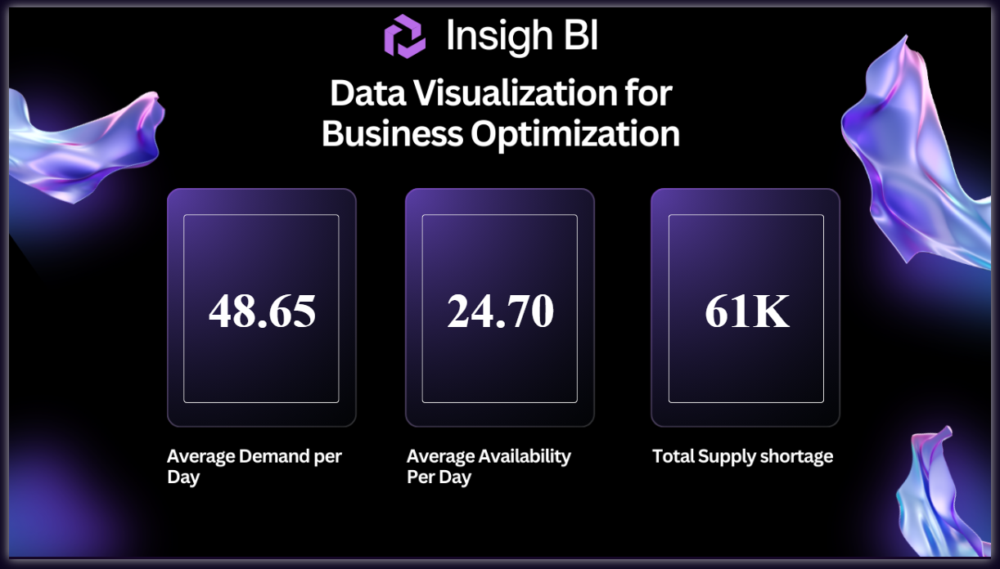

# 📦 Product Inventory & Demand Analysis | SQL Server, MySQL & Power BI

An end-to-end data analytics project focused on analyzing product availability and demand across production and test inventory datasets. The project uses SQL Server and MySQL for data exploration, data validation, data cleaning, and table joins, with Power BI for interactive reporting and inventory performance visualization.

---

## Table of Contents

- [About the Project](#about-the-project)
- [Technologies Used](#technologies-used)
- [Dataset](#dataset)
- [Project Objectives](#project-objectives)
- [Project Workflow](#project-workflow)
- [SQL Analysis](#sql-analysis)
- [Power BI Dashboard](#power-bi-dashboard)
- [Key Findings](#key-findings)
- [Business Recommendations](#business-recommendations)
- [How to Run](#how-to-run)
- [Project Structure](#project-structure)
- [Future Improvements](#future-improvements)
- [Author](#author)

---

## About the Project

The objective of this project is to explore product inventory data and understand the relationship between product availability and demand across production and test environments.

The project combines inventory records with product information to create a consolidated dataset for further analysis and visualization.

SQL is used to inspect datasets, identify distinct values, validate product IDs, handle product ID inconsistencies, and join inventory records with product details. Power BI is used to present the data through an interactive report that supports inventory monitoring and comparison.

This project demonstrates practical skills in SQL querying, relational data analysis, data validation, data transformation, and business intelligence reporting.

---

## Technologies Used

- **SQL Server (SSMS)** — database exploration, data validation, data cleaning, joins, and table creation.
- **MySQL Workbench** — database management, SQL queries, and merging inventory and product tables.
- **Power BI Desktop** — interactive dashboards and data visualization.
- **CSV and Excel** — dataset storage, data import, and inspection.
- **SQL** — filtering, `DISTINCT`, `COUNT`, `LEFT JOIN`, `UPDATE`, and `SELECT INTO`.

---

## Dataset

The project contains three primary datasets.

| Dataset | Description | Records |
|---|---|---:|
| Production Environmental Inventory | Production inventory records containing dates, product IDs, availability, and demand. | 1,043 |
| Test Environmental Inventory | Test inventory records containing dates, product IDs, availability, and demand. | 99 |
| Product | Product master data containing product IDs, names, and unit prices. | 20 |

**Total inventory records:** 1,142 across the production and test datasets.

### Key Columns

- `Order Date` — date associated with an inventory record.
- `Product ID` — identifier used to connect inventory records with the product master table.
- `Availability` — recorded availability value for a product.
- `Demand` — recorded demand value for a product.
- `Product Name` — name of the product.
- `Unit Price` — listed price of the product.

**Data note:** The production dataset contains product IDs 21 and 22, while the product master table contains 20 product IDs. The SQL scripts map IDs 21 and 22 to IDs 7 and 11, respectively. These mappings should be verified against the source data before being treated as confirmed business rules.

---

## Project Objectives

- Explore production and test inventory datasets using SQL.
- Validate product IDs and inspect distinct values across important columns.
- Identify inconsistencies between inventory records and the product master table.
- Apply the documented product ID mappings to standardize product references.
- Combine inventory data with product names and unit prices using SQL joins.
- Create consolidated tables for further analysis.
- Build a Power BI report to communicate inventory and demand patterns.

---

## Project Workflow

1. **Data Import:** Imported CSV and Excel datasets into relational databases.
2. **Data Exploration:** Examined table structures, row counts, distinct values, and key columns.
3. **Data Validation:** Checked for missing values and inconsistencies in product IDs.
4. **Data Cleaning:** Applied product ID corrections documented in the SQL scripts.
5. **Data Integration:** Used `LEFT JOIN` to combine inventory records with the product master table.
6. **Table Creation:** Created consolidated tables for subsequent analysis.
7. **Visualization:** Used Power BI to present inventory data and support analysis.

---

## SQL Analysis

The SQL scripts cover the following operations:

- Database creation and table exploration.
- Record counts and distinct-value analysis.
- Checks for missing or empty values.
- Identification and correction of inconsistent product IDs.
- Joining inventory datasets with product information using `LEFT JOIN`.
- Creating consolidated tables using `SELECT INTO` in SQL Server.
- Creating joined tables using `CREATE TABLE ... AS SELECT` in MySQL.

### Example: Joining Inventory and Product Data

```sql
SELECT
    ENV.Order_Date_DD_MM_YYYY,
    ENV.Product_ID,
    ENV.Availability,
    ENV.Demand,
    PROD.Product_Name,
    PROD.Unit_Price
FROM [dbo].[Test-Environmental-Inventory] AS ENV
LEFT JOIN [dbo].[Product] AS PROD
    ON ENV.Product_ID = PROD.Product_ID;
```

This query combines inventory records with product details using `Product_ID`, retaining inventory records even when a matching product record is unavailable.

---

## Power BI Dashboard

The Power BI report provides a visual interface for exploring the inventory data.

Add screenshots of your actual Power BI report pages to the `screenshots/` folder, then update the image filenames below to match the files you upload.

### Dashboard Preview




> **Note:** These are suggested screenshot names and section headings. Replace them with your actual report page names and screenshots. Remove any sections that do not correspond to a page in your report.

---

## Key Findings

- The production inventory dataset contains **1,043 records**.
- The test inventory dataset contains **99 records**.
- The product master table contains **20 products**.
- The production dataset contains two product IDs that require mapping to IDs in the product master table.
- SQL joins can combine inventory measurements with product names and unit prices for consolidated analysis.

Further findings about availability, demand, product performance, and differences between production and test environments should be added after validating the Power BI results.

---

## Business Recommendations

- Monitor products where recorded demand is high relative to availability.
- Investigate repeated low-availability records to identify potential inventory risks.
- Compare production and test inventory patterns to identify unusual differences.
- Validate product ID mappings before using the consolidated dataset for operational decisions.
- Use inventory trends to support replenishment planning and product-level monitoring.

These are potential recommendations based on the project's analytical scope, not confirmed operational outcomes.

---

## How to Run

### 1. Download or Clone the Repository

```bash
git clone YOUR_GITHUB_REPOSITORY_URL
```

Alternatively, download the repository as a ZIP file and extract it.

### 2. Import the Datasets

Import the CSV files from the `data/` folder into your database using SQL Server Management Studio or MySQL Workbench, depending on the SQL scripts you intend to run.

Ensure the table names and column names match those referenced in the scripts.

### 3. Run the SQL Scripts

Open the relevant `.sql` files in SQL Server Management Studio or MySQL Workbench.

Execute the scripts in the appropriate order, ensuring that the database and source tables exist before running the queries that reference them.

**Important:** The project contains scripts for both SQL Server and MySQL. Their syntax and table naming conventions differ, so execute each script in its intended database environment.

### 4. Open the Power BI Report

Open `powerbi/PROD Power BI Report.pbix` using Power BI Desktop.

If the report prompts you to reconnect to data sources, update the connection settings and verify that the underlying tables and columns are available.

### 5. Add Dashboard Screenshots to GitHub

1. Open the report in Power BI Desktop.
2. Navigate to the report page you want to showcase.
3. Export the page or capture a clear screenshot.
4. Save the image in the `screenshots/` folder using a descriptive filename.
5. Update the corresponding Markdown image reference in this README.
6. Commit and push the README and screenshot files to GitHub.

---

## Project Structure

```text
Product-Inventory-Demand-Analysis/
│
├── README.md
│
├── data/
│   ├── Prod-Env-Inventory-Dataset.csv
│   ├── Product.csv
│   ├── Product.xlsx
│   ├── Test-Environmental-Inventory.csv
│   └── Test-Environmental-Inventory.xlsx
│
├── sql/
│   ├── Exploring Table In SQL.sql
│   ├── Merging tables in wrokbench.sql
│   ├── My_SQL_Workbench_DataImporting.sql
│   ├── NEWTABLE.sql
│   ├── prod-env-inventory-dataset.sql
│   └── product-dataset.sql
│
├── powerbi/
│   └── PROD Power BI Report.pbix
│
└── screenshots/
    ├── page1.png
    ├── page2.png
```

---

## Future Improvements

- Develop additional KPIs for inventory coverage and demand-to-availability ratios.
- Add time-based comparisons to track changes in inventory and demand.
- Investigate and document the business rules behind product ID mappings.
- Create automated data quality checks to flag missing products and inconsistent records.
- Enhance the Power BI report with interactive filters, drill-through analysis, and inventory risk indicators.
- Introduce reliable replenishment and stockout indicators if the necessary operational data becomes available.

---

## Author

**Aakanksha Haravde**

Aspiring Data Analyst | SQL | Power BI | Data Analytics
